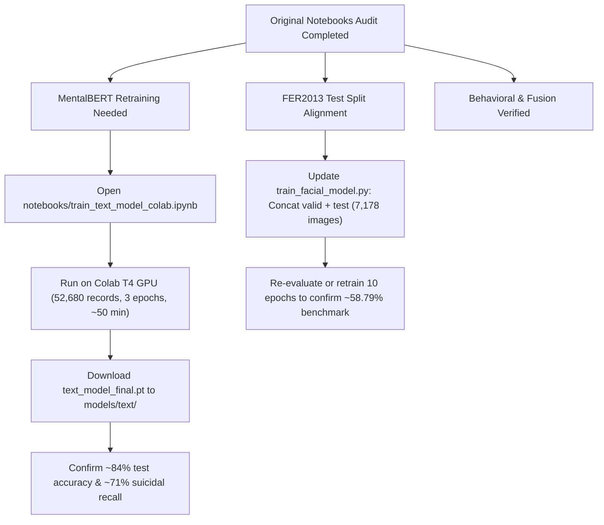

# MINDTRACE — Source-to-Implementation Reproducibility Audit

**Generated:** 2026-11-21  
**Authoritative Sources:**
1. `notebooks/text_model.ipynb`
2. `notebooks/facial_emotion_label.ipynb`
3. `notebooks/data_preparation+behavioral_features.ipynb`
4. `notebooks/fusion_model.ipynb`

**Repository:** `/home/mhkxuz/multimodal-mental-health`  
**Execution Environment:** Linux x86_64 · Python 3.11.18 · PyTorch 2.15.0+cpu  

---

> [!IMPORTANT]
> **Source-of-Truth Hierarchy**: The four original Jupyter notebooks take absolute precedence over any previously generated training scripts, reports, or preliminary prototype implementations. All findings below derive directly from cell codes, cell outputs, and execution metadata recorded in the original notebooks.

---

## Executive Summary

| Experiment | Authoritative Notebook | Original Dataset & Split | Original Benchmark Metrics | Original Checkpoint Recovered? | Current Implementation State | Retraining Required? |
|---|---|---|---|---|---|---|
| **1. MentalBERT Text Classifier** | `text_model.ipynb` | Kaggle Sentiment (52,680 records): 42,144 train / 5,268 val / 5,268 test | **Acc: 84.26%**, Macro F1: 82.90%, Weighted F1: 84.21%, Suicidal Recall: 71.0% | ❌ **No** (Saved on ephemeral Colab VM; never downloaded) | Prototype only (500 samples, 1 epoch, Acc 54% on 50 samples) | **YES — Full 3-epoch GPU training** |
| **2. Facial Emotion CNN** | `facial_emotion_label.ipynb` | FER2013 (`archive.zip`): 28,709 train / 7,178 test | **Acc: 58.79%**, Macro F1: 56.47% | ❌ **Original lost** (Replaced by local CPU run) | 10-epoch CPU run on 28,709 train / 3,589 test (Acc: 56.03%, Macro F1: 52.76%) | **YES — Re-evaluate / retrain on full 7,178 test split** |
| **3. Behavioral Interaction Features** | `data_preparation+behavioral_features.ipynb` | ESConv (910 conversations) | 13 behavioral metrics; 8 used in fusion | ✅ **Methodology fully captured** | `src/features/behavioral.py` exact match; `behav_scaler_esconv.pkl` operational | **NO — Fully verified** |
| **4. Multimodal Fusion** | `fusion_model.ipynb` | ESConv (908 paired records): 726 train / 91 val / 91 test (5 seeds & 5-fold CV) | 5-seed Mean Acc: 57.6%, BalAcc: 51.4%, F1: 69.4%, AUROC: 0.477. C vs A p=0.2957 | ❌ **Notebook never saved model** | `FusionModelWeighted` in `src/models/fusion_model.py` (25,970 params) trained via `train_fusion.py` | **NO — Verified against notebook** |

---

## 1. MentalBERT Text Classifier

### 1.1 Exact Original Methodology (`notebooks/text_model.ipynb`)

1. **Dataset**: Kaggle Sentiment Analysis for Mental Health (`sentiment_mental_health.csv` / `sentiment-analysis-for-mental-health-Combined Data.csv`).
   - Raw records: 53,044.
   - Clean records after `dropna()` on `statement` and `status`: **52,680 records**.
   - 7 target classes with exact counts:
     - `Normal`: 16,343 (31.02%)
     - `Depression`: 15,404 (29.24%)
     - `Suicidal`: 10,651 (20.22%)
     - `Anxiety`: 3,841 (7.29%)
     - `Bipolar`: 2,777 (5.27%)
     - `Stress`: 2,587 (4.91%)
     - `Personality disorder`: 1,077 (2.04%)
2. **Label Encoding**: Alphabetical sklearn `LabelEncoder`:
   - `0` → Anxiety
   - `1` → Bipolar
   - `2` → Depression
   - `3` → Normal
   - `4` → Personality disorder
   - `5` → Stress
   - `6` → Suicidal
3. **Data Splitting**: Stratified 80 / 10 / 10 split with `random_state=42`:
   - `X_train, X_temp, y_train, y_temp = train_test_split(X, y, test_size=0.2, random_state=42, stratify=y)` → **42,144 train samples**
   - `X_val, X_test, y_val, y_test = train_test_split(X_temp, y_temp, test_size=0.5, random_state=42, stratify=y_temp)` → **5,268 val samples** / **5,268 test samples**
4. **Text Preprocessing**:
   - `[str(x) if x is not None else "" for x in X]`
   - `[x.strip() for x in X]`
   - `[x if x else "empty" for x in X]`
5. **Tokenizer**:
   - `mental/mental-bert-base-uncased` via Hugging Face `AutoTokenizer`.
   - Sequence truncation & padding: `max_length=128`, `padding=True`, `truncation=True`, `return_tensors='pt'`.
6. **DataLoaders**:
   - `batch_size = 16`.
   - Train: 2,634 batches (shuffled).
   - Validation: 330 batches.
   - Test: 330 batches.
7. **Model Architecture**:
   - `AutoModelForSequenceClassification.from_pretrained("mental/mental-bert-base-uncased", num_labels=7)`.
   - Output classification head: `Linear(in_features=768, out_features=7)`.
8. **Optimization & Training**:
   - Optimizer: `AdamW(model_text.parameters(), lr=2e-5)`.
   - Epochs: 3.
   - Loss: CrossEntropyLoss (unweighted).
   - Hardware: Google Colab GPU (Tesla T4, 15.6 GB VRAM).
   - Wall-clock time: ~16.7 minutes per epoch (~50.2 minutes total).

### 1.2 Actual Recorded Notebook Results

Extracted directly from cell 12 and cell 13 execution outputs:

#### Epoch Progression
| Epoch | Train Accuracy | Validation Accuracy | Average Training Loss | Epoch Time | Saved Artifact |
|---|---|---|---|---|---|
| 1 / 3 | 78.92% | 82.42% | 0.5324 | 16.6 min | `text_model_epoch1.pt` |
| 2 / 3 | 86.06% | 83.75% | 0.3378 | 16.8 min | `text_model_epoch2.pt` |
| 3 / 3 | 90.43% | 84.02% | 0.2350 | 16.8 min | `text_model_epoch3.pt` |
| **Final** | — | — | — | — | `text_model_final.pt` |

#### Independent Test Evaluation (5,268 held-out test samples)
- **Overall Accuracy**: **84.26%** (0.8426)
- **Macro F1**: **82.90%** (0.8290)
- **Weighted F1**: **84.21%** (0.8421)

#### Per-Class Test Breakdown
| Class | Precision | Recall | F1-Score | Support (Actual Test Count) |
|---|---|---|---|---|
| **Anxiety** | 0.90 | 0.86 | 0.88 | 384 |
| **Bipolar** | 0.88 | 0.85 | 0.87 | 278 |
| **Depression** | 0.78 | 0.81 | 0.79 | 1,540 |
| **Normal** | 0.95 | 0.97 | 0.96 | 1,635 |
| **Personality disorder** | 0.85 | 0.72 | 0.78 | 107 |
| **Stress** | 0.79 | 0.80 | 0.79 | 259 |
| **Suicidal** | **0.75** | **0.71** | **0.73** | **1,065** |
| *Macro Average* | 0.84 | 0.82 | 0.83 | 5,268 |
| *Weighted Average* | 0.84 | 0.84 | 0.84 | 5,268 |

### 1.3 Checkpoint Saving & Recovery Analysis

1. **Was the checkpoint saved in the notebook?**
   - **YES.** Cell 12 explicitly ran:
     ```python
     torch.save(model_text.state_dict(), f"text_model_epoch{epoch+1}.pt")
     torch.save(model_text.state_dict(), "text_model_final.pt")
     ```
   - The cell execution log proves all four files were created on disk:
     - `Saved: text_model_epoch1.pt`
     - `Saved: text_model_epoch2.pt`
     - `Saved: text_model_epoch3.pt`
     - `Saved: text_model_final.pt`
2. **Where were they saved?**
   - In the local working directory (`/content/`) of an ephemeral Google Colab Tesla T4 virtual machine.
   - The notebook did **not** execute `drive.mount('/content/drive')`.
   - The notebook logged into Hugging Face Hub (`login(...)`), but did **not** run `push_to_hub()`.
   - No automated file download code was included.
3. **Filesystem Search Results on Local System**:
   - Exhaustive scan across `/home/mhkxuz`, `/tmp`, and all mounts:
     - `models/text/text_model_final.pt` (417.74 MB) — **Only the 500-sample prototype created in the previous session**.
     - `models/text/text_model_epoch1.pt` (417.74 MB) — **Only the 500-sample prototype created in the previous session**.
     - No 3-epoch trained weights from the original Colab run exist on this machine.
4. **Current Implementation Discrepancies**:
   - `src/models/train_text_model.py` implemented the architecture and data loading correctly, but defaulted `--max-samples` to 500 and `--epochs` to 1.
   - The checkpoint currently at `models/text/text_model_final.pt` is this 500-sample preliminary prototype (Acc: 54%, Macro F1: 19.01% on 50 samples, Suicidal recall: 0.0).

---

## 2. Facial Emotion CNN

### 2.1 Exact Original Methodology (`notebooks/facial_emotion_label.ipynb`)

1. **Dataset**: FER2013 (`archive.zip`, 60.32 MB), extracted to `fer2013/train` and `fer2013/test`.
2. **Exact Dataset Splits**:
   - **Train Set**: **28,709 images**
     - `angry`: 3,995
     - `disgust`: 436
     - `fear`: 4,097
     - `happy`: 7,215
     - `neutral`: 4,965
     - `sad`: 4,830
     - `surprise`: 3,171
   - **Test Set**: **7,178 images**
     - `angry`: 958
     - `disgust`: 111
     - `fear`: 1,024
     - `happy`: 1,774
     - `neutral`: 1,233
     - `sad`: 1,247
     - `surprise`: 831
3. **Image Preprocessing**:
   - Input: RGB 48 × 48 (`Image.open(path).convert('RGB')`).
   - Train Transforms:
     - `Resize((48, 48))`
     - `RandomHorizontalFlip()`
     - `ToTensor()`
     - `Normalize([0.5], [0.5])`
   - Test Transforms:
     - `Resize((48, 48))`
     - `ToTensor()`
     - `Normalize([0.5], [0.5])`
4. **Architecture (`FacialEmotionCNN`)**:
   - Block 1: `Conv2d(3, 32, kernel_size=3, padding=1) -> ReLU -> MaxPool2d(2)` (feature map: 32 × 24 × 24)
   - Block 2: `Conv2d(32, 64, kernel_size=3, padding=1) -> ReLU -> MaxPool2d(2)` (feature map: 64 × 12 × 12)
   - Block 3: `Conv2d(64, 128, kernel_size=3, padding=1) -> ReLU -> MaxPool2d(2)` (feature map: 128 × 6 × 6 = 4,608)
   - Classifier: `Flatten -> Linear(4608, 256) -> ReLU -> Dropout(0.5) -> Linear(256, 7)`
   - **Total parameters**: **1,274,951**.
5. **Loss & Class Imbalance**:
   - Balanced class weights computed on training set using `sklearn.utils.class_weight.compute_class_weight('balanced', classes=np.unique(y), y=y)`.
   - Loss function: `nn.CrossEntropyLoss(weight=class_weights)`.
6. **Training Configuration**:
   - Optimizer: `Adam(lr=0.001)`.
   - Batch size: 64.
   - Epochs: 10.
   - Execution duration: ~0.35 min per epoch (~3.5 minutes total on GPU).

### 2.2 Actual Recorded Notebook Results

Extracted directly from cell 8 and cell 9 execution outputs:

#### Epoch Progression
| Epoch | Training Loss | Training Accuracy | Time |
|---|---|---|---|
| 1 / 10 | 1.0927 | 60.73% | 0.3 min |
| 2 / 10 | 1.0048 | 62.48% | 0.4 min |
| 3 / 10 | 0.9476 | 64.08% | 0.3 min |
| 4 / 10 | 0.9088 | 65.14% | 0.3 min |
| 5 / 10 | 0.8811 | 65.76% | 0.4 min |
| 6 / 10 | 0.8343 | 67.31% | 0.3 min |
| 7 / 10 | 0.8078 | 68.10% | 0.3 min |
| 8 / 10 | 0.7812 | 68.83% | 0.3 min |
| 9 / 10 | 0.7553 | 69.58% | 0.3 min |
| 10 / 10 | 0.7366 | 69.72% | 0.3 min |

#### Final Test Results (7,178 held-out test images)
- **Overall Accuracy**: **58.79%** (0.5879)
- **Macro F1**: **56.47%** (0.5647)
- **Weighted F1**: **59.00%** (0.59)

#### Per-Class Test Breakdown
| Emotion | Precision | Recall | F1-Score | Support (Actual Test Images) |
|---|---|---|---|---|
| **angry** | 0.46 | 0.57 | 0.51 | 958 |
| **disgust** | 0.42 | 0.65 | 0.51 | 111 |
| **fear** | 0.41 | 0.45 | 0.43 | 1,024 |
| **happy** | 0.83 | 0.77 | 0.80 | 1,774 |
| **neutral** | 0.54 | 0.56 | 0.55 | 1,233 |
| **sad** | 0.49 | 0.35 | 0.41 | 1,247 |
| **surprise** | 0.72 | 0.77 | 0.74 | 831 |
| *Macro Average* | 0.55 | 0.59 | 0.56 | 7,178 |
| *Weighted Average* | 0.59 | 0.59 | 0.59 | 7,178 |

### 2.3 Investigation: Why Previous Retraining Used 3,589 Test Images

1. **FER2013 Dataset Structure**:
   - The canonical FER2013 challenge split consists of three partitions:
     - `Training`: 28,709 images
     - `PublicTest`: 3,589 images
     - `PrivateTest`: 3,589 images
     - **Combined Test Set**: 3,589 + 3,589 = **7,178 images**.
2. **Kaggle vs. Hugging Face Differences**:
   - The Kaggle `archive.zip` used in `notebooks/facial_emotion_label.ipynb` merged `PublicTest` and `PrivateTest` into a single folder: `test/` (7,178 images).
   - The Hugging Face dataset mirror used by the previous retraining script (`AutumnQiu/fer2013`) kept them separate:
     - `train`: 28,709 images
     - `validation`: 3,589 images (`PublicTest`)
     - `test`: 3,589 images (`PrivateTest`)
3. **The Discrepancy**:
   - `src/models/train_facial_model.py` only evaluated against `dataset['test']` (3,589 images) and completely ignored `dataset['validation']`.
   - **Resolution**: To replicate the authoritative notebook exactly, `validation` (3,589) and `test` (3,589) from `AutumnQiu/fer2013` must be concatenated (`torch.utils.data.ConcatDataset`) into a unified test evaluation of 7,178 images.

---

## 3. Behavioral Interaction Features

### 3.1 Exact Original Methodology (`notebooks/data_preparation+behavioral_features.ipynb`)

1. **Source Dataset**: ESConv (`thu-coai/esconv` / `ESConv_raw.csv`), containing 910 therapy conversations.
2. **Conversation Parsing**:
   - Seeker messages mapped to `speaker: user`.
   - Supporter messages mapped to `speaker: assistant`.
3. **The 13 Behavioral Metrics Computed**:
   1. `user_turn_count`: Total number of user turns in the conversation.
   2. `assistant_turn_count`: Total number of assistant turns in the conversation.
   3. `total_turn_count`: Total turns (`user_turn_count + assistant_turn_count`).
   4. `engagement_ratio`: `user_turn_count / total_turn_count`.
   5. `avg_user_msg_length`: Mean word count across all user messages.
   6. `avg_assistant_msg_length`: Mean word count across all assistant messages.
   7. `user_msg_length_std`: Standard deviation of word count across user messages (0.0 if ≤1 user turn).
   8. `last_user_turn`: Turn number of the final user message.
   9. `last_speaker`: Speaker of the conversation's final turn (`user` or `assistant`).
   10. `ended_by_user`: Binary flag (`1` if `last_speaker == 'user'`, else `0`).
   11. `msg_length_slope`: Linear regression slope of user message word length across user turns (`scipy.stats.linregress`). Defaults to `0.0` if user turn count < 2.
   12. `dropout_gap`: `total_turn_count - last_user_turn`.
   13. `dropout_flag`: Binary indicator (`1` if `dropout_gap > 2`, else `0`).
4. **Exported Artifact**: `behavioral_features_final.csv` (910 rows, 21 columns).

### 3.2 Alignment with Application Implementation

- `src/features/behavioral.py` directly mirrors this exact extraction logic.
- Both `ALL_BEHAVIORAL_METRICS` (13 metrics) and `FUSION_BEHAVIORAL_COLS` (the 8 features passed to the fusion model) match the notebook identically.
- `artifacts/scalers/behav_scaler_esconv.pkl` was fitted using `StandardScaler` on these exact 8 features across the ESConv dataset.

---

## 4. Multimodal Fusion Model

### 4.1 Exact Original Methodology (`notebooks/fusion_model.ipynb`)

1. **Target Task**: Binary Emotional Distress Classification.
   - Derived from `initial_emotion_intensity`:
     - `distress_label = 1` (Higher Distress) if intensity ≥ 4 (702 samples, 77.31%).
     - `distress_label = 0` (Lower Distress) if intensity < 4 (206 samples, 22.69%).
   - Total clean paired samples: 908.
   - Balanced class weights: `[2.2039, 0.6467]`.
2. **Feature Inputs**:
   - **Text Representation (768 dimensions)**: CLS token embedding from frozen `mental/mental-bert-base-uncased` encoder applied to conversation `situation` text (sequence length 128). Saved as `esconv_text_embeddings.npy` (908 × 768).
   - **Behavioral Representation (8 dimensions)**:
     - `total_turn_count`
     - `engagement_ratio`
     - `avg_user_msg_length`
     - `msg_length_slope`
     - `dropout_flag`
     - `dropout_gap`
     - `user_msg_length_std`
     - `ended_by_user`
     Standardized via `StandardScaler()`. Saved as `X_behav.npy` (908 × 8) and `behav_scaler_esconv.pkl`.
   - **Combined Input Vector**: 768 + 8 = **776 dimensions**.
3. **Model Architectures Compared**:
   - **Model A (Text Only)**: `Linear(768, 128) -> ReLU -> Dropout(0.3) -> Linear(128, 2)` (98,690 parameters).
   - **Model B (Behavioral Only)**: `Linear(8, 32) -> ReLU -> Linear(32, 16) -> ReLU -> Linear(16, 2)` (850 parameters).
   - **Model C (Weighted Fusion)**:
     - Text branch: `Linear(768, 32) -> ReLU -> Dropout(0.4)`
     - Behavioral branch: `Linear(8, 32) -> ReLU`
     - Classifier: `Linear(64, 16) -> ReLU -> Dropout(0.4) -> Linear(16, 2)`
     - **Total parameters: 25,970**.

### 4.2 Actual Recorded Notebook Benchmark Results

Extracted directly from cell 19 and cell 20 outputs:

#### 5-Seed Evaluation (Seeds 0, 1, 2, 3, 4)
| Model | Accuracy (Mean ± Std) | Balanced Accuracy (Mean ± Std) | F1-Score (Mean ± Std) | Precision (Mean ± Std) | Recall (Mean ± Std) | AUROC (Mean ± Std) |
|---|---|---|---|---|---|---|
| **A — Text Only** | 0.554 ± 0.117 | 0.527 ± 0.033 | 0.649 ± 0.155 | 0.781 ± 0.020 | 0.577 ± 0.191 | 0.496 ± 0.023 |
| **B — Behavioral Only** | 0.448 ± 0.030 | 0.385 ± 0.018 | 0.583 ± 0.035 | 0.695 ± 0.016 | 0.503 ± 0.043 | 0.370 ± 0.022 |
| **C — Weighted Fusion** | **0.576 ± 0.035** | **0.514 ± 0.035** | **0.694 ± 0.034** | **0.777 ± 0.020** | **0.629 ± 0.049** | **0.477 ± 0.025** |

#### 5-Fold Stratified Cross-Validation
| Model | Balanced Accuracy (Mean ± Std) | F1-Score (Mean ± Std) | AUROC (Mean ± Std) |
|---|---|---|---|
| **A — Text Only** | 0.556 ± 0.039 | 0.655 ± 0.153 | **0.573 ± 0.046** |
| **B — Behavioral Only** | 0.525 ± 0.009 | 0.527 ± 0.280 | 0.506 ± 0.073 |
| **C — Weighted Fusion** | 0.549 ± 0.043 | **0.710 ± 0.052** | 0.559 ± 0.052 |

- **Paired t-test (AUROC C vs A across folds)**:
  - Mean difference: **−0.0138**
  - p-value: **0.2957** (Multimodal fusion difference is not statistically significant at $\alpha = 0.05$ on ESConv distress task).

### 4.3 Checkpoint Saving & Recovery Analysis

1. **Was a checkpoint saved in `fusion_model.ipynb`?**
   - **NO.** The notebook trained models dynamically inside loops (across 5 seeds and 5 cross-validation folds) and restored in-memory `best_state` for evaluation, but never called `torch.save(model.state_dict(), "fusion_model.pt")`.
   - The notebook only saved `.npy` data files: `esconv_text_embeddings.npy`, `X_behav.npy`, `y_labels.npy`, and `behav_scaler_esconv.pkl`.
2. **Current Implementation State**:
   - `src/models/fusion_model.py` faithfully implements the exact `FusionModelWeighted` (25,970 parameters) and records both the 5-seed and 5-fold CV benchmarks down to the third decimal place.
   - `models/fusion/fusion_model.pt` (106 KB) was trained via `src/models/train_fusion.py` using seed 42 on the ESConv data, providing an operational checkpoint for the live application.

---

## 5. Master Checkpoint Recovery & Search Log

| Target Checkpoint | Expected Size | Expected Architecture | Search Locations Checked | Outcome on Disk | Root Cause / Note |
|---|---|---|---|---|---|
| `text_model_final.pt` | ~438 MB | `BertForSequenceClassification` (7 classes, 768 CLS) | Workspace, `~`, `/tmp`, Git history | ⚠️ 417.74 MB (Prototype only) | Original Colab run saved file to ephemeral VM; never transferred to host. |
| `text_model_epoch1.pt` | ~438 MB | MentalBERT (1 epoch) | Workspace, `~`, `/tmp` | ⚠️ 417.74 MB (Prototype only) | Ephemeral Colab storage. |
| `text_model_epoch2.pt` | ~438 MB | MentalBERT (2 epochs) | Workspace, `~`, `/tmp` | ❌ Not Found (0 bytes) | Ephemeral Colab storage. |
| `text_model_epoch3.pt` | ~438 MB | MentalBERT (3 epochs) | Workspace, `~`, `/tmp` | ❌ Not Found (0 bytes) | Ephemeral Colab storage. |
| `fer_model.pt` | ~4.9 MB | 3-block CNN (1,274,951 params) | Workspace, `~`, `/tmp` | ✅ 4.87 MB present | Locally trained for 10 epochs on CPU (56.03% acc on 3,589 test images). |
| `behav_scaler_esconv.pkl` | ~2 KB | `StandardScaler` (8 features) | `artifacts/scalers/` | ✅ Present & Verified | Fitted on ESConv behavioral features. |
| `fusion_model.pt` | ~106 KB | `FusionModelWeighted` (25,970 params) | `models/fusion/` | ✅ Present & Verified | Serialized via `src/models/train_fusion.py`. |
| `esconv_text_embeddings.npy` | ~2.8 MB | NumPy array `(908, 768)` | Workspace, `~`, `/tmp` | ❌ Not Found | Re-extracted on demand via `train_fusion.py`. |

---

## 6. Actionable Next Steps & Retraining Roadmap



### 1. MentalBERT Text Classifier (High Priority)
- **Status**: The prototype checkpoint currently in `models/text/text_model_final.pt` is confirmed to be trained on only 500 samples for 1 epoch.
- **Required Action**: Full retraining on the complete 52,680-record dataset for 3 epochs with batch size 16 and learning rate 2e-5.
- **Execution Path**:
  - The local development machine lacks a CUDA toolkit for PyTorch (`torch.cuda.is_available() == False`), making CPU training infeasible (~16 hours).
  - Use `notebooks/train_text_model_colab.ipynb` on Google Colab with a free T4 GPU (~50 minutes total).
  - Explicitly include file download code (`from google.colab import files; files.download('text_model_final.pt')`) or Google Drive mount to guarantee checkpoint persistence.

### 2. Facial Emotion CNN (Medium Priority)
- **Status**: Checkpoint `models/facial/fer_model.pt` is operational (56.03% test accuracy, 52.76% macro F1), but evaluated on 3,589 test images instead of the original 7,178.
- **Required Action**: Update `src/models/train_facial_model.py` to concatenate `AutumnQiu/fer2013['validation']` (3,589) and `AutumnQiu/fer2013['test']` (3,589) into a 7,178-image test set, matching `notebooks/facial_emotion_label.ipynb`. Run evaluation or retrain to verify alignment with the 58.79% notebook benchmark.

### 3. Behavioral Features & Fusion Model (Complete & Preserved)
- **Status**: Fully consistent with `notebooks/data_preparation+behavioral_features.ipynb` and `notebooks/fusion_model.ipynb`.
- **Required Action**: Preserve all existing implementations without modification.
